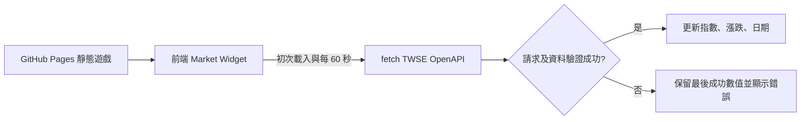

# TAIEX 指數顯示整合計畫（GitHub Pages 靜態遊戲）

> 文件用途：供其他 Coding Agent 直接評估、實作與驗收。  
> 狀態：實作計畫；尚未在目標 Repository、實際瀏覽器及 GitHub Pages 網域完成驗證。  
> 更新日期：2026-10-23

## 1. 需求與範圍

在既有的 GitHub Pages 純靜態網頁遊戲中，新增一個**唯讀台灣加權股價指數（TAIEX）資訊區塊**，包含：

- 最近交易日的加權股價指數。
- 相較前一交易日的漲跌點數及漲跌百分比。
- 行情資料日期與來源。
- 頁面開啟後立即讀取，之後每 60 秒重新查詢一次。
- API 失敗時顯示狀態、保留上次成功的數值；不得顯示虛構數據。

**重要：本計畫使用官方「盤後」資料，並非盤中即時報價。** 60 秒是輪詢間隔，不代表行情每 60 秒更新。畫面不得標示「即時」、「Live」或暗示盤中即時行情。

### 不在本次範圍

- 不修改原有遊戲玩法、分數、狀態管理及資料儲存邏輯。
- 不新增伺服器、資料庫、第三方追蹤工具或需要保密的 API Key。
- 不將指數用於遊戲結果判定。
- 不使用未授權的即時行情轉播或不明第三方 CORS Proxy。

## 2. 資料來源與授權前提

**首選資料來源：臺灣證券交易所（TWSE）OpenAPI**

- API：`https://openapi.twse.com.tw/v1/exchangeReport/MI_INDEX`
- 官方入口：<https://openapi.twse.com.tw/>
- 官方網站：<https://www.twse.com.tw/>
- 政府資料開放平臺：<https://data.gov.tw/>

依先前研究，此 API 提供盤後指數資料；相應開放資料集曾標示政府資料開放授權條款第 1 版。**正式部署前，Agent 必須重新確認 API 目前的欄位格式、資料集對應關係、開放授權條款及公開網站使用條件。** 不得以「可以呼叫」推論「允許任意轉播」。在 UI 標示「資料來源：臺灣證券交易所」。

若日後改為盤中即時或延遲報價，需先確認資料供應商授權、展示條件與費用，不得直接改接證交所 MIS 或其他非正式端點。

## 3. 架構



優先採用純前端串接。**前置驗證：** 在正式 GitHub Pages 網域使用瀏覽器 DevTools 檢查是否通過 CORS。若遭 CORS 阻擋，停止直連方案，改為提出 Cloudflare Worker 中介方案並取得確認；不可用 `mode: 'no-cors'`（會得到不可讀取的回應）。

## 4. UI 規格

資訊卡片顯示：

```text
台灣加權股價指數
23,482.61
▲ +128.32 (+0.55%)
行情日期：YYYY/MM/DD
最近交易日收盤資料
資料來源：臺灣證券交易所
```

以上數值僅為 UI 示意，**不得寫死在正式畫面**。台股常見慣例為上漲紅色、下跌綠色；不得僅依顏色區分漲跌，還要顯示正負號或箭頭。支援手機窄螢幕，不得遮蔽遊戲主要操作區。失敗時顯示「資料更新失敗」或「暫時無法取得行情」。

## 5. API 欄位與解析要求

先以實際 API 回應確認欄位，預期需解析：

- `指數`：選擇 `發行量加權股價指數`。
- `收盤指數`：指數值。
- `漲跌`：漲跌方向（注意可能包含不同字元或空白）。
- `漲跌點數`：點數幅度。
- `漲跌百分比`：百分比。
- `日期`：若為民國年月日格式，須正確轉換西元。

**解析防護：** 不可假定上述欄位與格式永遠不變。驗證回應是否為陣列、是否存在目標指數、所有數值是否有效、百分比是否帶有 `%`、正負方向是否一致、日期格式是否符合預期。任何驗證失敗均不可將 `NaN`、`undefined` 或錯誤日期顯示給使用者。不得憑空補出缺少的漲跌數據。

## 6. 參考實作（獨立 JavaScript 模組）

下列程式為**可整合的參考範本，尚未針對當前官方回應實測**。Agent 應先確認實際 JSON 欄位，再依情況調整解析器。

HTML 容器：

```html
<section class="market-widget" aria-label="台灣加權股價指數">
  <h3>台灣加權股價指數</h3>
  <div id="taiex-value">--</div>
  <div id="taiex-change">--</div>
  <div id="taiex-date">行情日期：--</div>
  <div id="taiex-status" role="status">載入中…</div>
  <small>資料來源：臺灣證券交易所｜最近交易日收盤資料</small>
</section>
<script src="./market.js" defer></script>
```

`market.js`：

```javascript
const MARKET_API = 'https://openapi.twse.com.tw/v1/exchangeReport/MI_INDEX';
const POLL_INTERVAL_MS = 60_000;
const $ = (selector) => document.querySelector(selector);

function parseNumeric(raw) {
  if (raw === null || raw === undefined || String(raw).trim() === '') {
    return NaN;
  }
  return Number(String(raw).replace(/,/g, '').replace(/%/g, '').trim());
}

function parseMarketDate(raw) {
  const s = String(raw ?? '').trim();
  // 預期民國年 YYYMMDD；若實際 API 不同，先修正此函式。
  if (!/^\d{7}$/.test(s)) throw new Error('不支援的行情日期格式');
  const year = Number(s.slice(0, 3)) + 1911;
  const month = Number(s.slice(3, 5));
  const day = Number(s.slice(5, 7));
  const date = new Date(Date.UTC(year, month - 1, day));
  if (date.getUTCFullYear() !== year || date.getUTCMonth() !== month - 1 || date.getUTCDate() !== day) {
    throw new Error('無效的行情日期');
  }
  return `${year}/${String(month).padStart(2, '0')}/${String(day).padStart(2, '0')}`;
}

function parseMarket(records) {
  if (!Array.isArray(records)) throw new Error('行情格式非陣列');
  const item = records.find(x => String(x?.['指數'] ?? '').trim() === '發行量加權股價指數');
  if (!item) throw new Error('找不到加權股價指數');

  const value = parseNumeric(item['收盤指數']);
  const magnitude = parseNumeric(item['漲跌點數']);
  const percentMagnitude = parseNumeric(item['漲跌百分比']);
  if (![value, magnitude, percentMagnitude].every(Number.isFinite)) {
    throw new Error('行情數值無效');
  }

  const direction = String(item['漲跌'] ?? '').trim();
  // 方向格式需以實際 API 驗證；未知方向不可猜測。
  let sign;
  if (['+', '＋'].includes(direction)) sign = 1;
  else if (['-', '－', '−'].includes(direction)) sign = -1;
  else if (['', '0'].includes(direction) && magnitude === 0 && percentMagnitude === 0) sign = 0;
  else throw new Error(`無法辨識漲跌方向: ${direction}`);

  return {
    value,
    change: sign * Math.abs(magnitude),
    percent: sign * Math.abs(percentMagnitude),
    date: parseMarketDate(item['日期'])
  };
}

async function updateMarket() {
  try {
    const response = await fetch(MARKET_API, { cache: 'no-store' });
    if (!response.ok) throw new Error(`HTTP ${response.status}`);
    const market = parseMarket(await response.json());
    $('#taiex-value').textContent = market.value.toLocaleString('en-US', {
      minimumFractionDigits: 2, maximumFractionDigits: 2
    });
    const sign = market.change > 0 ? '+' : '';
    const pctSign = market.percent > 0 ? '+' : '';
    $('#taiex-change').textContent = `${sign}${market.change.toFixed(2)} (${pctSign}${market.percent.toFixed(2)}%)`;
    $('#taiex-change').className = market.change > 0 ? 'market-up' : market.change < 0 ? 'market-down' : '';
    $('#taiex-date').textContent = `行情日期：${market.date}`;
    $('#taiex-status').textContent = '最近交易日收盤資料';
  } catch (error) {
    console.error('[Market]', error);
    $('#taiex-status').textContent = '行情更新失敗；保留上次成功資料';
  }
}

updateMarket();
setInterval(() => {
  if (!document.hidden) updateMarket();
}, POLL_INTERVAL_MS);
```

**注意：** `漲跌`、`日期` 等欄位是待核對假設。若 API 實際以其他符號表示漲跌，應依官方格式修正，不可將未知符號一律視為平盤。

CSS 範例：

```css
.market-widget {
  max-width: 380px;
  padding: 18px;
  border: 1px solid #2d3b52;
  border-radius: 14px;
  background: #0c1525;
  color: #f7fafc;
  font-family: system-ui, sans-serif;
}
#taiex-value { font-size: 2rem; font-weight: 700; font-variant-numeric: tabular-nums; }
.market-up { color: #ff6262; }
.market-down { color: #35d49a; }
#taiex-date, #taiex-status, .market-widget small { color: #aebdd0; }
```

## 7. 實作順序

1. 確認現有遊戲前端框架、入口檔與 CSS 命名方式；避免覆蓋原本樣式。
2. 查證官方 API 現況、授權、欄位與實際 JSON；使用真實樣本修正解析器。
3. 在 GitHub Pages 實際網域測試 `fetch`、CORS、回應狀態與網路錯誤。
4. 將行情資訊卡整合進既有 UI，避免全域樣式衝突。
5. 設定每 60 秒查詢；避免重複初始化造成多組計時器，元件卸載時應清除計時器。
6. 驗證手機版、休市日、網路中斷、API 異常、資料缺漏及日期格式。
7. 完成後再進行部署；未經授權不得自行更改原有遊戲邏輯。

## 8. 驗收標準

- [ ] GitHub Pages 頁面可正常載入，遊戲原有功能不受影響。
- [ ] 可讀取最近交易日的加權股價指數及漲跌數據。
- [ ] 每 60 秒嘗試重新查詢，不誤稱為即時行情。
- [ ] 假日、休市日正確顯示最後交易日資料日期。
- [ ] 上漲紅色、下跌綠色，並顯示正負號。
- [ ] API 失敗時不清空上次成功的有效數據，也不顯示假數據。
- [ ] 未在公開前端儲存任何私密 API Key。
- [ ] 已確認公開展示的資料授權與來源標示。
- [ ] 實際 GitHub Pages 網域 CORS 測試通過；否則提出替代方案。
- [ ] 手機與桌機排版正常，無主遊戲 UI 遮擋。

## 9. 風險與替代方案

| 風險 | 對策 |
|---|---|
| API 不允許瀏覽器跨網域存取 | 改用 Cloudflare Worker 代理，並確認來源授權 |
| 官方欄位或日期格式異動 | 集中維護解析器，驗證失敗保留上次有效數值 |
| 盤中數字不更新 | 清楚標示「盤後資料」及行情日期 |
| 過度頻繁查詢或供應商限流 | 遵守官方限制；必要時使用快取或降低頻率 |
| 公開展示授權不明 | 停止公開上線，先確認官方資料集授權 |

## 10. 給 Coding Agent 的最終指示

> 請在現有 GitHub Pages 靜態遊戲中，以最小修改整合台灣加權股價指數資訊卡。首選 TWSE 官方盤後 OpenAPI，查詢間隔 60 秒。先驗證實際 JSON、公開展示授權與 GitHub Pages CORS，再實作。不可誤稱即時行情、不可使用未授權資料源、不可更動原有遊戲邏輯。API 失敗需安全降級，並回報實測結果及仍存在的限制。
